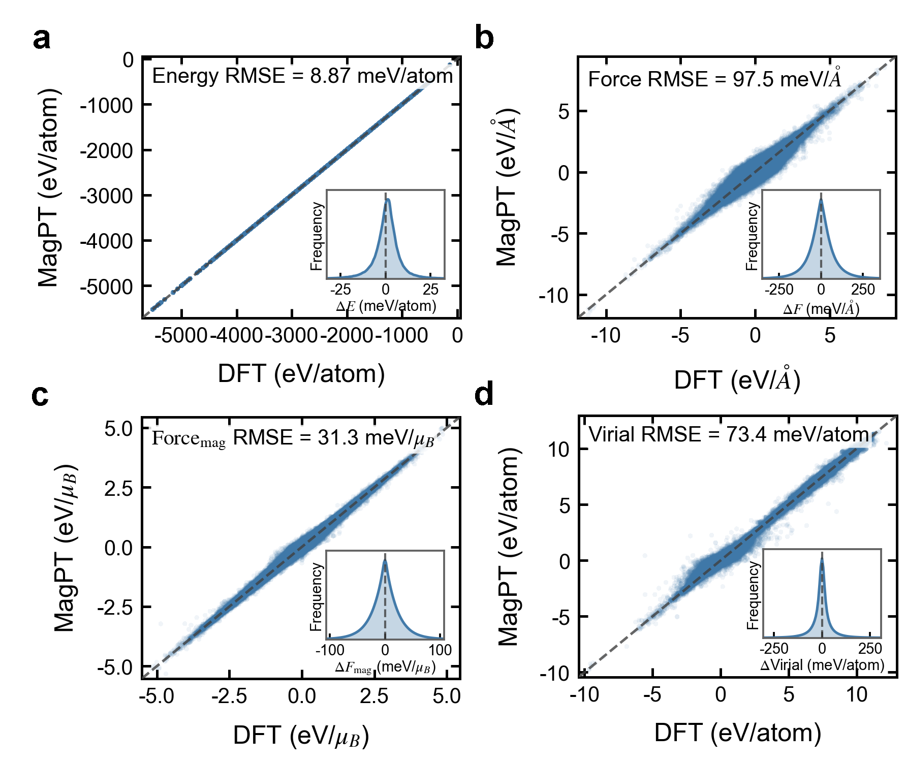

# MagPT: Non-Collinear Magnetic Dataset and Base Model

[](https://arxiv.org/abs/XXXX.XXXXX)
[](https://huggingface.co/datasets/shiruosong/MagPT)
[](https://www.gnu.org/licenses/lgpl-3.0)

## Table of Contents

- [MagPT: Non-Collinear Magnetic Dataset and Base Model](#magpt-non-collinear-magnetic-dataset-and-base-model)
  - [Table of Contents](#table-of-contents)
  - [Overview](#overview)
  - [Dataset](#dataset)
  - [Model](#model)
  - [Usage](#usage)
    - [ASE](#ase)
    - [DeePMD-kit](#deepmd-kit)
    - [Evaluate the Model](#evaluate-the-model)
  - [Repository Contents](#repository-contents)
  - [Citation](#citation)
  - [License](#license)

## Overview

MagPT is an open dataset and base model for **non-collinear magnetic materials**, covering **48 metal elements**. The full dataset contains **912,492 entries**, generated by **active learning from spin-lattice coupled MD trajectories** (**0–1000 K, 0–10 GPa**) with DFT calculations using **non-collinear magnetism, SOC, and DeltaSpin** constraints. This release provides a subset of **399,168 entries** from the full dataset.

## Dataset

The released subset (**399,168 entries**, 2.2 GB) is hosted on Hugging Face because it is too large for this GitHub repository.

- 📦 **[Download the MagPT dataset from Hugging Face](https://huggingface.co/datasets/shiruosong/MagPT)**
- Format: **extxyz**
- Read with ASE:

```python
from ase.io import read

for atoms in read("./examples/example.xyz", index=":"):
    print(atoms.get_chemical_formula(), atoms.get_potential_energy())
```

- Units: position in $\mathrm{\AA}$, spin in $\mu_{\mathrm{B}}$, energy in eV, force in eV/$\mathrm{\AA}$, magnetic force in eV/$\mu_{\mathrm{B}}$, virial in eV

## Model

The released model is stored at `model/MagPT_399168.pth`. It is retrained **only on the released 399,168 frames**, not on the full 912,492-entry dataset.

The figure below shows the parity plots for four physical quantities predicted by the model on the released 399,168 frames:

<p align="center">
  
</p>

Root-mean-square errors (RMSE) on the released 399,168 frames:

| Quantity | Unit | RMSE |
| --- | --- | ---: |
| Energy | meV/atom | 8.87 |
| Force | meV/$\mathrm{\AA}$ | 97.5 |
| Magnetic force | meV/$\mu_{\mathrm{B}}$ | 31.3 |
| Virial | meV/atom | 73.4 |

## Usage

Running the examples requires **ASE** and **DeePMD-kit**.

### ASE

ASE can be installed directly from PyPI:

```bash
pip install ase
```

### DeePMD-kit

MagPT runs on a DeePMD-kit branch with some spin-related modifications:

- 🔗 Official repository: **[deepmodeling/deepmd-kit](https://github.com/deepmodeling/deepmd-kit)** — the original DeePMD-kit developed by the DeepModeling community, on which this work is based
- 🔗 MagPT branch: **[MagTheoryLab/deepmd-kit — `spin_virial_master_port`](https://github.com/MagTheoryLab/deepmd-kit/tree/spin_virial_master_port)** — based on the official DeePMD-kit with spin-related modifications originally contributed by **[Duo Zhang](https://github.com/iProzd/deepmd-kit)**, and maintained by our team
- Compile this branch following the official DeePMD-kit instructions: **[Install from source code](https://docs.deepmodeling.com/projects/deepmd/en/latest/install/install-from-source.html)**

### Evaluate the Model

The `examples/` directory contains a minimal XYZ file and two evaluation scripts:

- `examples/example.xyz` — Minimal 3-frame XYZ for quick format testing
- `examples/eval_frame.py` — Evaluate a single frame
- `examples/eval.py` — Batch evaluation against DFT results

```bash
# Single-frame evaluation
python eval_frame.py MagPT_399168.pth example.xyz -i 0

# Batch evaluation and comparison with DFT
python eval.py MagPT_399168.pth example.xyz
```

The model file `MagPT_399168.pth` is included in this repository.

## Repository Contents

- `model/MagPT_399168.pth` — Base model trained on the released 399,168 entries
- `abacus/` — ABACUS pseudopotentials, orbitals, and INPUT files
- `examples/` — XYZ example and evaluation scripts
- `figs/` — Parity plots for model evaluation
- `LICENSE` — LGPL-3.0
- `README.md`

## Citation

```bibtex
@article{magpt,
  title   = {TBD},
  author  = {TBD},
  journal = {arXiv preprint arXiv:XXXX.XXXXX},
  year    = {TBD},
  url     = {https://arxiv.org/abs/XXXX.XXXXX}
}
```

## License

**GNU Lesser General Public License v3.0 (LGPL-3.0)**

